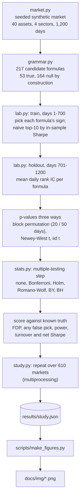
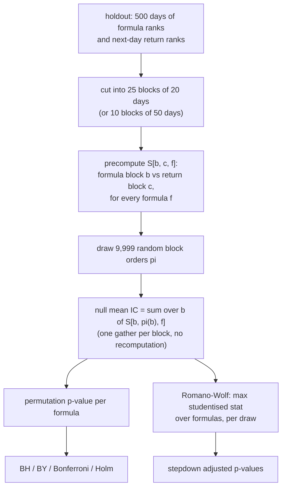
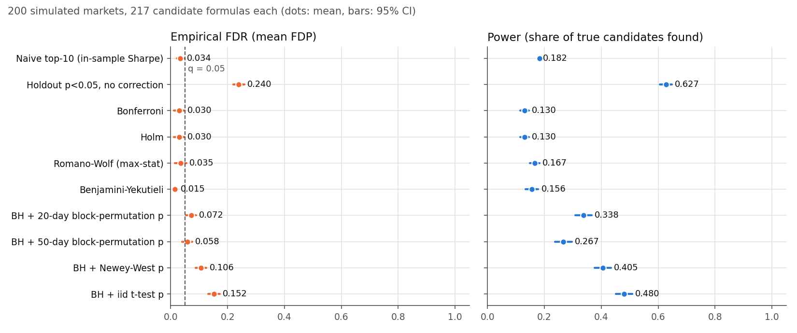
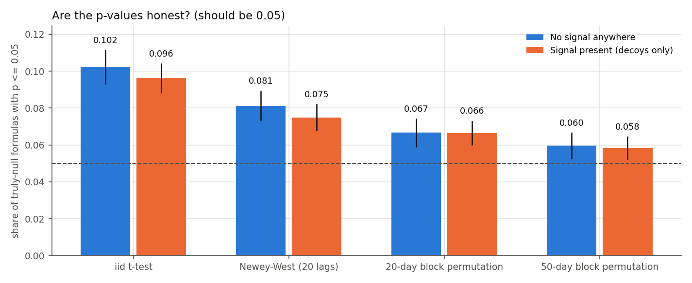
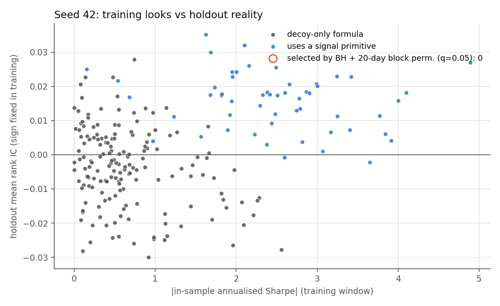

# False-Discovery Alpha Screening Lab

> I could make 50 random formulas look like alpha in an afternoon. So how do you know which ones are real?

This started as a small experiment and kept growing. With a few hundred "alpha" formulas, *something* will always backtest well, even on pure noise. In the null-only runs below, the best in-sample formula had a median annualised Sharpe of **2.0**, and there was nothing to find. Multiple-testing corrections like Benjamini–Hochberg are supposed to fix this. I wanted to check whether they actually do once the data has the kind of dependence real markets have: overlapping formulas, persistent features, sector structure.

To make that checkable I needed **ground truth**, so everything here runs on a synthetic market where I know which formulas are real. That's also the main limitation (see "What this isn't"). All numbers below come from the runs saved in `results/`.

## TL;DR

From `results/study.json`: 200 simulated markets, 217 candidate formulas each (53 real, 164 null by construction), target q = 0.05.

- **BH is only as good as its p-values.** Fed plain iid t-test p-values, BH's empirical FDR was **0.152** [0.132, 0.173], three times the target. With no signal anywhere, **43%** of markets still got at least one false "discovery".
- **Block-permutation p-values mostly fix it, but not completely.** BH + 20-day block permutation: FDR **0.072** [0.054, 0.090] with power **0.338**. Longer 50-day blocks: FDR 0.058 (CI covers 0.05) but power drops to 0.267.
- **The naive "top-10 by backtest Sharpe" trap depends on signal strength.** At scale 1 only 3–4% of its picks were decoys; at the weakest signal (scale 0.25) it was **62%** decoys.
- **One seed tells you very little.** In seed 42, BH found **zero** of the 53 true formulas. Averaged over 200 markets it found 34%.

## Architecture



## What I built

- **A synthetic market with known truth (`market.py`).** 40 assets, 4 sectors, 1,200 days. Ten AR(1) "primitives" `x0..x9` per asset; only `x0` (slow) and `x1` (fast) move next-day returns. On top: a market factor, sector shocks, persistent sector/asset drift and fat-tailed noise.
- **A formula grammar (`grammar.py`).** `x`, `ts_mean(x,5/10/20)`, `delta(x,1/5/20)`, `ts_zscore(x,20/60)`, `sector_neutral(x)`, `add`/`sub(x,y)` of cross-sectional z-scores and `ts_corr(x,y,20)`. That enumerates 217 candidates: 53 use a signal primitive ("true"), 164 use only decoys ("null by construction").
- **A clean train/holdout split (`lab.py`).** Days 1–700 choose each formula's sign and the naive baseline (top-10 by |in-sample Sharpe|). Days 701–1200 are never touched in training.
- **Three kinds of p-value.** 20/50-day block permutation (9,999 draws), Newey–West t, and a plain iid t.
- **Six selection rules (`stats.py`).** No correction, Bonferroni, Holm, Romano–Wolf max-stat stepdown, Benjamini–Yekutieli and Benjamini–Hochberg, plus deflated Sharpe, Li–Ji effective tests and Wilson/normal CIs.
- **A Monte-Carlo driver (`study.py`).** 200 main markets, 100 null-only markets, a 7-point signal-strength sweep (30 each), and two regime-shift scenarios (50 each), all with fixed seeds.
- **A toy cost model.** Linear 5 bps per unit traded, so I can see which "discoveries" survive turnover.

Some design decisions and why:

- **Null by construction.** The decoy primitives come from a separate random stream from the returns, so any formula built only from decoys has exactly zero population IC. I left out two formula types where the truth would be fuzzy: `sub(x0, x1)`, which could cancel out, and `ts_corr` involving a signal primitive, which has zero IC by symmetry even though it isn't independent of returns.
- **Near-duplicates on purpose.** `x7`, `ts_mean(x7,5)`, `ts_mean(x7,10)` and so on are almost the same bet. In seed 42, **66** candidate pairs have |correlation| > 0.8, and the Li–Ji eigenvalue estimate says the 217 formulas behave like about **83** independent tests. This is the "tweak the window until it works" trap.
- **Dependence on purpose.** The features are persistent (AR coefficients up to 0.99), and the returns have slow-moving sector and asset drifts. As a result, a decoy's daily IC is autocorrelated, which is exactly what breaks naive t-tests.
- **Romano–Wolf** uses the same permutation draws. The statistics are studentised by their own permutation-null spread, so fast and slow formulas compete fairly in the max-statistic.
- **Every grammar operator is causal.** A test perturbs future inputs and checks that past values are unchanged. Another test checks that changing the holdout regime can't change any training-window decision.

## How it works

The expensive part is the block-permutation null: 9,999 shuffles × 217 formulas × hundreds of markets. The trick that makes it cheap: for a block permutation π, the holdout mean IC equals `sum_b S[b, π(b)]`, where `S` is a precomputed block-by-block cross-product matrix. So 9,999 permutations cost about 25 array gathers instead of 9,999 full recomputations. A unit test checks this against the direct reindexing.



Keeping whole 20-day blocks together preserves the short-range serial dependence inside each block, which is what the iid t-test ignores. It doesn't preserve dependence longer than a block, and that shows up in the results below.

## Results

`python -m alpha_screen.study --profile full`. Main scenario: **200 simulated markets**, signal scale 1 (estimated population rank IC of raw `x0` ≈ 0.027), q = 0.05. "Empirical FDR" is the mean false-discovery proportion across markets. Power is the share of the 53 true formulas found. The naive top-10 power is capped at 10/53 ≈ 0.19.



| Method | Empirical FDR [95% CI] | P(≥1 false pick) [Wilson 95%] | Power [95% CI] | Avg picks |
|---|---|---|---|---|
| Naive top-10 by in-sample Sharpe (no holdout test) | 0.034 [0.021, 0.046] | 0.180 [0.133, 0.239] | 0.182 [0.180, 0.185] | 10.0 |
| Holdout p ≤ 0.05, no correction | 0.240 [0.221, 0.258] | 0.995 [0.972, 0.999] | 0.627 [0.606, 0.649] | 44.2 |
| Bonferroni | 0.030 [0.011, 0.049] | 0.075 [0.046, 0.120] | 0.130 [0.115, 0.145] | 7.0 |
| Holm | 0.030 [0.011, 0.049] | 0.075 [0.046, 0.120] | 0.130 [0.115, 0.145] | 7.0 |
| Romano–Wolf max-stat stepdown | 0.035 [0.015, 0.055] | 0.105 [0.070, 0.155] | 0.167 [0.150, 0.184] | 9.1 |
| Benjamini–Yekutieli | 0.015 [0.007, 0.024] | 0.095 [0.062, 0.144] | 0.156 [0.133, 0.179] | 8.5 |
| **BH + 20-day block-permutation p** | **0.072** [0.054, 0.090] | 0.440 [0.373, 0.509] | **0.338** [0.308, 0.367] | 19.6 |
| BH + 50-day block-permutation p | 0.058 [0.041, 0.076] | 0.345 [0.283, 0.413] | 0.267 [0.238, 0.296] | 15.3 |
| BH + Newey–West t p | 0.106 [0.087, 0.126] | 0.655 [0.587, 0.717] | 0.405 [0.376, 0.434] | 24.5 |
| BH + plain iid t-test p | **0.152** [0.132, 0.173] | 0.840 [0.783, 0.884] | 0.480 [0.452, 0.509] | 30.7 |

**Null-only control** (100 markets, no signal anywhere): the naive top-10 is 100% false, and uncorrected p ≤ 0.05 picks 14.45 false formulas per market on average. The share of markets with at least one false pick (which equals FDR here) was:

- 0.010 [0.002, 0.054] for BY
- 0.080 [0.041, 0.150] for Bonferroni/Holm
- 0.090 [0.048, 0.162] for BH with either block length
- 0.110 [0.063, 0.186] for Romano–Wolf
- 0.230 [0.158, 0.322] for BH + Newey–West
- **0.430** [0.337, 0.528] for BH + iid t

**Are the p-values honest?** Across truly-null formulas, this is the share with p ≤ 0.05. It should be 0.05.



| p-value | null-only (100 markets) | main (200 markets) |
|---|---|---|
| plain iid t-test | 0.102 [0.093, 0.111] | 0.096 [0.089, 0.104] |
| Newey–West, 20 lags | 0.081 [0.073, 0.089] | 0.075 [0.068, 0.082] |
| 20-day block permutation | 0.067 [0.059, 0.074] | 0.066 [0.060, 0.073] |
| 50-day block permutation | 0.060 [0.053, 0.066] | 0.058 [0.052, 0.064] |

**Signal-strength sweep** (30 markets per scale; full curves in `results/study.json`):


- At scale 0.25 (IC ≈ 0.008), the naive top-10 was 62% decoys. At scale 0.5 it was 39%. It only becomes "safe" once the signal is strong enough to dominate the in-sample Sharpe ranking: 3–4% decoys at scale 1 (main and sweep runs), 0% at 1.5 and above.
- BH (20-day blocks) power went 0.01 → 0.07 → 0.13 → 0.42 → 0.70 → 0.88 across scales 0.25 → 2.0. Its FDR ranged from 0.03 to 0.15 across scales. At the weak scales (0.25/0.5) it sat above q, with wide CIs because few picks are made.

**Regime shift** (50 markets each). If the signal halves in the holdout, BH (20-day) power falls from 0.338 to 0.043. If the signal dies completely, every pick is false: BH made 0.4 picks per market on average, and 10% of markets had at least one. Uncorrected testing had 98% of markets with a false pick.

**Costs.** Across the 3,920 BH (20-day) discoveries in the main scenario, **63.6%** still had positive holdout Sharpe after 5 bps per unit of turnover. The median per-market mean annualised Sharpe dropped from 2.59 gross to 0.45 net. In seed 42, the slow raw signal `x0` went from 1.63 to 0.97 (turnover 0.25/day). The fast `x1` went from 2.00 to −0.91 (turnover 1.09/day): real, but you can't trade it after costs.

**Deflated Sharpe.** In the main scenario, the naive in-sample winner was a true formula in 99% of markets, but its deflated Sharpe ratio (434 trials counted) never cleared 0.95. In the null-only runs it cleared 0.95 once in 100. With this many correlated trials, DSR was very conservative here. It only flagged 15/30 winners at scale 2.

### What surprised me

1. **BH is only as good as the p-values you feed it.** On the same formulas, plain iid t-tests gave BH an FDR of 0.152, three times the target. Under the global null, 43% of markets had a false "discovery". Newey–West helped but still over-rejected. The procedure was fine. The problem was serial dependence leaking into the p-values.
2. **Even the block permutation isn't perfect.** With features as persistent as AR 0.99, 20-day blocks cut through dependence that lasts longer than 20 days. Null p ≤ 0.05 happened 6.6% of the time instead of 5%, which pushed BH's FDR to 0.072 [0.054, 0.090]. Longer 50-day blocks got closer (0.058, CI covers 0.05) but lost power (0.338 → 0.267). I didn't expect that tradeoff to be visible this clearly.
3. **The naive trap depends on signal strength.** I assumed the naive top-10 would always be full of decoys. In this setup it's mostly fine when the true signal is strong and very bad when it's weak or absent, and that's exactly when you'd most want to believe it.
4. **One seed tells you very little.** In seed 42 at the default strength, BH found **zero** of the 53 true formulas. Averaged over 200 markets it found 34%. The plot below shows seed 42: the true formulas mostly do have positive holdout IC, but none cleared BH with 20-day block-permutation p-values.



### What the numbers do NOT show

- **Anything about real markets.** Every number is from my generator. Real alphas are weaker, non-stationary, and nobody hands you the ground truth.
- **That BH + block permutation is "safe" in general.** It still overshot q here (0.072 vs 0.05), and a different dependence structure could make it better or worse.
- **Tight answers at weak signal.** At scales 0.25/0.5 few picks are made, so the FDR CIs are wide.
- **That one market is representative.** Seed 42 is a showcase, not evidence; it is the opposite of the 200-market average for BH.

## Run it yourself

**Prerequisites:** Python 3.10+ and NumPy. matplotlib is only needed for the PNGs.

```sh
git clone https://github.com/nikhils23j/false-discovery-alpha-screening-lab.git
cd false-discovery-alpha-screening-lab
python3 -m venv .venv && source .venv/bin/activate
python -m pip install -r requirements.txt
```

**Quickstart** (about a minute; the quick profile took 55 s):

```sh
python -m alpha_screen.study --profile quick --output results/quick.json
```

`results/quick.json` is git-ignored so it won't clobber the recorded full run.

**Full evaluation** (writes `results/study.json`):

```sh
python -m alpha_screen.study --profile full --workers 8
python scripts/make_figures.py          # redraws docs/img/*.png from results/study.json only
```

The recorded full run used 9,999 permutations, 200 + 100 + 7×30 + 2×50 = 610 markets, plus 8 long runs to estimate population IC. I couldn't get a clean timing because other jobs were loading the machine heavily (load average 80–220). The recorded run took 1,467 s of wall time and a second run took 1,173 s, with 2,500–2,740 CPU-seconds each. On a quiet 8-core M2 that should come to roughly 6–7 minutes, but that's an estimate I haven't measured. The second run reproduced every aggregate in `results/study.json` exactly, because the seeds are fixed. The JSON also stores the command, environment, seeds and config.

The original 50-candidate, 12-asset experiment is still there and gives the same output as before (a few seconds each):

```sh
python -m alpha_screen --seed 42 --permutations 499 --output results/seed42.json
python -m alpha_screen --seed 42 --permutations 499 --signal-scale 0 --output results/null-seed42.json
```

Seed 42: BH picked **5/5** injected signals and **0/45** decoys. The naive in-sample top-10 had 5 decoys. The null control picked 0/50. Those five signals are much stronger than the ones in the main study, so read it as a sanity check, not evidence.

### Try to fool it yourself

- Change `MarketConfig` in `alpha_screen/market.py`: push `drift_phi` or the decoy `persistence` closer to 1 and see the iid-t FDR blow up, or shrink `signal_loadings` and see the naive top-10 fill with decoys.
- Add operators to `alpha_screen/grammar.py`, e.g. more window lengths of the same formula. More near-duplicates should hurt Bonferroni more than Romano–Wolf, which uses the joint permutation distribution. That's the theory; check whether the numbers agree.
- `run_trial(seed, holdout_multiplier=0.0, detail=True)` gives you per-formula p-values for a market where the signal died. Try to find a selection rule that looks good there and also passes the main scenario.
- Swap in your own p-value (bootstrap, a different HAC lag) and check it against the calibration table before trusting any FDR claim.

## Tests

```sh
python -m unittest discover -s tests -v       # 25 tests, about 2 s
```

What they cover:

- **Procedures by hand:** BH (including the step-up rescue of a larger p, ties and input validation), BY, Holm and Bonferroni against hand-computed answers, and that the procedures nest the way theory says they should.
- **Permutation machinery:** the permutation p-value formula, the fast `S[b, π(b)]` block permutation against direct reindexing, Romano–Wolf matching the plain permutation p for one hypothesis and never going below the raw p.
- **Statistics:** Newey–West with lag 0 equals the iid standard error and widens for persistent series; deflated Sharpe falls as trials grow; Wilson intervals and Li–Ji effective tests.
- **No leakage:** every grammar expression is causal, operators match naive loops, decoys don't depend on signal strength, the holdout multiplier only changes holdout returns, and training decisions ignore the holdout.
- **Original experiment:** reproducible market, block-shuffle invariants, BH step-up rule, and the signal and null controls.

## Project layout

```
.
├── alpha_screen/
│   ├── core.py        original 50-candidate experiment (unchanged)
│   ├── market.py      synthetic market with dependence and regime switch
│   ├── grammar.py     causal operators + candidate enumeration
│   ├── stats.py       BH, BY, Bonferroni, Holm, Romano-Wolf, Newey-West, DSR, Li-Ji, CIs
│   ├── lab.py         one trial: train/holdout split, p-values, procedures, costs
│   ├── study.py       Monte-Carlo driver (multiprocessing) -> results/study.json
│   └── plots.py       chart code used by scripts/make_figures.py
├── results/
│   ├── study.json     full Monte-Carlo run (610 markets)
│   ├── seed42.json    original experiment, signal on
│   └── null-seed42.json  original experiment, null control
├── scripts/
│   └── make_figures.py   draws docs/img/*.png from results/study.json only
├── docs/img/          README charts
├── tests/             25 unittest cases
└── INTERVIEW_NOTES.md design decisions, results and likely questions
```

## What this isn't / limits

- **Not real-market evidence.** The market is a simple generator I wrote. Real alphas are weaker, non-stationary, and nobody hands you the ground truth.
- **Not a general statement about BH.** The FDR numbers hold for this generator, this grammar, 500 holdout days and these dependence settings. A different dependence structure could make the block permutation better or worse.
- **Not a trading strategy.** The Sharpe ratios are on synthetic returns with a toy cost model: linear 5 bps per unit traded, no impact, borrow or capacity limits.
- **Permutation resolution.** p-values bottom out at 1/10,000, and the 20-day test only has 25 blocks to shuffle. BY and Bonferroni are partly limited by that floor.
- **"True" includes weak formulas.** Some of the 53 (e.g. `delta(x0, 1)`) have tiny population IC. That's part of why power tops out where it does.

## More

The design decisions, the reasoning behind each one, and the questions I'd expect about this project are in [INTERVIEW_NOTES.md](INTERVIEW_NOTES.md).

Built as a personal project with AI pair-programming help.
